# Developing {{PROJECT_NAME}}

How to set up, run, debug and test this project. The {{LANGUAGE}}
specifics (test commands, debug configurations) are in
[language.md](language.md). Deploying is in the [README](../README.md).

## Where the code runs



There are three places to run the code. Use the first one unless you have a
reason not to.

| Place | Use it for | Set up with |
|---|---|---|
| **Your Mac, with mise** (the main way) | editing, unit tests, debugging, `make` commands | `make local-dev-setup` |
| **The devcontainer** (`.devcontainer/`) | code that needs a Linux system library, and a clean Linux toolchain | VS Code: *Reopen in Container* |
| **The deployed image** (`make local-build`, `.devcontainer/service/`, `.devcontainer/lambda/`) | checking what actually ships | `make local-build <target>` |

Three files decide what each place has:

- `mise.toml`: the language and tool versions on your Mac, and the version
  of every base image.
- `system_packages.txt` (runtime) and `system_packages_build.txt` (build):
  Debian packages for the devcontainer and the deployed images. Add a C
  library here, not in a Dockerfile.
- `.vscode/launch.json`: the debug configurations, the same on the Mac and
  in the devcontainer.

## Set up your Mac

Once per machine:

```zsh
curl https://mise.run | sh                        # or: brew install mise
echo 'eval "$(mise activate zsh)"' >> ~/.zshrc    # after any other environment's activation
```

Once per clone, and again after you edit `mise.toml` or a requirements file:

```zsh
make local-dev-setup
```

This installs the tools in `mise.toml` with `mise install`. For python it
also fills `./venv`. With mise activated, the tools are on `PATH` inside the
project. `make` commands find them even without activation.

Put `mise activate` after any other environment manager in `~/.zshrc`.
Otherwise an older tool from that environment can shadow a pinned one when
you type its name. `make` commands are not affected.

## The development loop



Each step is slower than the one before, and closer to production. Start at
the top. At the first failure, go back to editing.

| Step | Command | What it proves | Needs |
|---|---|---|---|
| 1. Unit tests | see [language.md](language.md), or F5 *Unit tests* | the logic works | nothing else |
| 2. Debug | F5 in VS Code | you can step through the failing path | nothing else |
| 3. Lint | `make lint` | versions agree with `mise.toml`, the code passes its linter, the CloudFormation templates pass cfn-lint | `make local-dev-setup` |
| 4. Build the image | `make local-build <target>` | the Dockerfile builds with the system packages | Docker |
| 5. Run the image | `make local-run ...`; for lambda, `make invoke JSON='<json>'` | the deployed image starts and answers | Docker |
| 6. Validate | `make validate <target>` | the templates and parameters are deployable | AWS credentials |
| 7. Deploy | `git push` / `make push` | the pipeline builds and deploys it | the pipeline stack |
| 8. Inspect | `make url`, `make logs`, `make events` | it runs in AWS | AWS credentials |

**`MODE=local`.** Deployed code reads its secrets from AWS Secrets Manager.
With `MODE=local`, it skips that read and uses local values instead. Every
debug configuration sets it, and `make local-run` sets it by default. Run
without it to test the real path against AWS.

## Debugging

Press **F5** in VS Code and pick a configuration. The configurations start
the same entry points the deployed images run: the task, the server, the
lambda handler, the unit tests. [language.md](language.md) lists them.

The same `.vscode/launch.json` works on your Mac and in the devcontainer.
Debug in the devcontainer when the code needs a Linux system library, or for
C++, whose debugger (gdb) is installed there.

The devcontainer follows your Mac's CPU architecture, so the debugger runs
natively. The deployed images build for the pipeline's architecture, which
can be emulated on your Mac. Debug the dev container, not a deployed image.

When the deployed image behaves differently from an F5 run, open
`.devcontainer/service/` or `.devcontainer/lambda/`. They build the deployed
image, so you can look at what it actually contains. `make shell` opens a
shell in a running `make local-run` container.

## Testing

| Level | Where the tests live | Runs |
|---|---|---|
| Unit | `tests/unit/` (elixir: `test/`) | on your Mac, in the devcontainer, F5 |
| Lint | the language's linter, plus cfn-lint | `make lint` |
| Image | the Dockerfile | `make local-build`, then `make local-run` / `make invoke` |
| Deployment | the CloudFormation templates | `make validate <target>` |

The pipeline's test stage (`RunTests` in `cicd_parameters.json`) runs
`pytest` and expects `tests/requirements.txt`. It is python-only, and
projects do not ship that file yet. Set `RunTests` to `"false"` until the
stage fits this project.

## The devcontainer

Open the project in VS Code and choose *Reopen in Container*. The picker
offers three configurations:

| Config | Builds | Use it for |
|---|---|---|
| `.devcontainer/` | `.devcontainer/Dockerfile` | day-to-day Linux work: toolchain, debugger, system packages |
| `.devcontainer/service/` | `targets/service/Dockerfile` | looking inside the deployed service image |
| `.devcontainer/lambda/` | `targets/lambda/Dockerfile` | looking inside the deployed lambda image |

What happens when it opens:

1. `init.sh` runs on your Mac. It checks the ssh agent, syncs the version
   lines from `mise.toml`, and refreshes the ECR Public login. If versions
   were out of step, it syncs them and stops: rebuild the container.
2. Docker builds the image. Both package lists are installed.
3. VS Code installs its server in the container. After a VS Code update it
   downloads the server again (about 200 MB), which can take minutes.
4. `post_create.sh` installs the AWS CLI, the Docker CLI and the dev tools.

The container mounts `~/.aws`, `~/.gitconfig`, `~/.ssh/config` and the
Docker socket. `make local-build`, `make local-run` and `make invoke` work
inside it, through your Mac's Docker. No private key is mounted: git uses
the forwarded ssh agent, so run `ssh-add ~/.ssh/<key>` on your Mac.

`make local-dev-setup` is not needed in the devcontainer: the image is the
environment.

## Troubleshooting

| Symptom | Cause | Fix |
|---|---|---|
| `make lint` fails with "disagree with mise.toml" | a version changed in `mise.toml` only | `make sync-versions` |
| A tool runs an unexpected version | another environment comes first on `PATH` | `mise activate` after it in `~/.zshrc`; `make` commands are not affected |
| *Reopen in Container* stops after "versions were out of step" | `init.sh` synced `mise.toml` changes | rebuild the container |
| *Reopen in Container* sits at "Downloading VS Code Server" | a VS Code update needs a new server | wait; it is cached afterwards |
| The container log shows `Exit code 1` lines | VS Code checks for files that a new container does not have yet | nothing: these are not errors |
| A build fails with "authorization token has expired" | an old ECR Public login | `init.sh` refreshes it; or `docker logout public.ecr.aws` |
| `ssh-keyscan` or a private git dependency fails in a build | no ssh agent key | `ssh-add ~/.ssh/<key>` on your Mac |
| A C library is missing in the image | it is not in a package list | add it to `system_packages.txt` or `system_packages_build.txt` |
